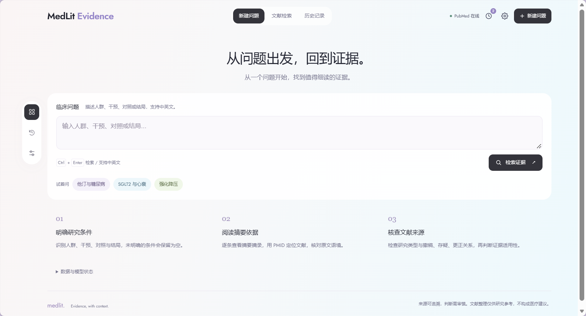

# MedLit Evidence

一个医学文献循证问答助手。你问一个临床问题，它去 PubMed 里翻文献，回来只告诉你三件事：

证据站在哪一边，有没有人在唱反调，这个结论值几分可信。

它不给你"标准答案"。大多数 AI 拿到一堆互相矛盾的文献，会替你"和稀泥"，给一个听起来很确定的结论，顺手还可能编几个不存在的 PMID。这个工具反着来，它把分歧摆到台面上，让你自己判断。

零密钥就能跑，断网了也能演示。后端三个依赖，前端一个静态页面。



## 一句话看懂它是什么

**这是一个「帮你查医学证据、还帮你判断这份证据靠不靠谱」的助手。**

你问它一个临床问题（比如「这个药到底有没有效」），它替你翻遍几千万篇医学文献，然后不是甩给你一个「听起来很肯定」的答案，而是老老实实告诉你三件事：

1. **证据站在哪一边**：按每个结局逐条看，支持还是反对，原句直接摆出来
2. **有没有人在唱反调**：结论是不是互相打架，有分歧就明说，不和稀泥
3. **这个结论值几分可信**：自动核查偏倚、不一致性、间接性、不精确性、发表偏倚五个维度，资料缺在哪也如实标出来

它最特别的地方是：**别的 AI 会「和稀泥」，它专门把「争议」摆到台面上。** 因为它相信，医学决策最怕的不是「没答案」，而是「一个听起来很确定的假答案」。

## 它强在哪（优势）

跟直接用通用大模型（ChatGPT 这类）查医学问题相比，它有几个实打实的优势：

| 对比项 | 通用大模型 | 本项目 |
| --- | --- | --- |
| 给答案 | 倾向给一个「很确定」的结论，掩盖争议 | 明确标出「证据存在分歧」，把正反两边都列出来 |
| 引用文献 | 可能编造不存在的编号 | 每句话都锚定真实的文献编号，可点开核对 |
| 证据强弱 | 不区分「大研究」还是「小报告」 | 识别研究类型，按 GRADE 五维核查偏倚、不一致性、间接性、不精确性、发表偏倚 |
| 可不可信 | 不给量化依据 | 逐结局给方向结论和可信度初评，资料缺在哪也说明白 |
| 能不能追责 | 难，答错了不知道错在哪 | 每个结论都能追溯到原文，有开放全文还能定位到具体章节 |
| 撤稿文献 | 照用不误 | 单独标记，留在来源列表，但不污染结论 |

**一句话概括优势：它不装懂，而且每个结论都能让你自己去核实。**

## 它有什么用（用途）

**给谁用：**

- **医生 / 临床工作者**：查一个治疗方案，快速看清「证据到底站不站得住」，而不是被一两篇研究带偏
- **医学生 / 科研人员**：写论文、做综述时，快速摸清某个问题的证据全貌和争议点
- **医学编辑 / 审稿人**：一眼看出某篇文献「有没有被撤稿、风险高不高」

**几个具体场景：**

- 想知道「他汀会不会增加糖尿病风险」，它会告诉你「两边都有证据，存在分歧」，而不是替你拍板
- 检索结果里混进了**被撤稿的文献**，它会明确标记出来，并且不让这篇坏文献进入回答和模型上下文
- 拿不准一篇论文靠不靠谱，它会给出一个「研究分数」，帮你判断要不要重点核查
- 有开放全文的文献，它会自动抓正文、解析表格，把结论定位到具体章节，还附来源文件的 SHA256

**更长远的价值**：它不只是一次性问答工具，背后还搭了一套「撤稿风险预测 + 可信性交叉验证」的研究管线，目标是让「一篇论文将来会不会出事」这件事，能被数据提前预警，而不是等出事了才被发现。

## 它解决什么问题

查一个治疗方案有没有证据，会卡在两个地方。

第一，PubMed 有三千八百万篇文献。搜一个词，回来几十万条结果，没有研究类型标注，没有证据强弱区分，全靠人肉筛。

第二，更麻烦的是另一个问题。等你真把文献读完了，会发现结论互相打架：一篇说有效，一篇说没差异，还有一篇提醒你权衡副作用。通用大模型拿到这种材料，最省事的做法是抹平矛盾、给出确定答案。而循证医学的立身之本恰恰相反：把矛盾讲清楚，而不是假装它不存在。

这就是这个工具在解决的事。它把"搜文献"到"下判断"中间那段最费脑子的活，替你做掉。

## 核心创新：建模证据分歧，而不是给"标准答案"

### 大模型的"假共识"问题

通用大模型回答医学问题，有两个系统性风险：

1. **幻觉**。编造不存在的文献、数据、PMID。
2. **假共识**。把文献里本就对立的结论抹平，自信地给出一个确定答案。

医学编辑、医生、科研人员查文献，很多时候就是为了搞清楚一件事：这件事到底有没有争议。这个产品把这个需求显式地做成了能力，而不是靠模型"顺便"输出。

### 它是怎么做的

**逐结局方向结论**

先抽结论句，再判方向，一个结局一个结论。结论句优先取摘要里带 `CONCLUSIONS` / `FINDINGS` / `INTERPRETATION` 标签的句子，跳过 `DISCUSSION` / `LIMITATION` 段；按整节过滤背景和方法内容，保留结果里的不确定性表达。每个结论都带 PMID 和原句，可以点开核对。

**证据分歧检测**

统计所有结论句的方向，给一个总体判断：

- 同时有"支持"和"反对" → **证据存在分歧**
- 只有"支持" → **证据倾向支持**
- 只有"反对" → **证据倾向不支持**
- 其余 → **证据不足或未明确**

有分歧时，界面会高亮提示"文献结论存在对立，采信需谨慎"，并把正反两边的篇数都列出来。

**五维可信度初评（GRADE 五维）**

不是给一个黑箱分数，而是按 GRADE 的思路逐项核查：偏倚、不一致性、间接性、不精确性、发表偏倚。原文里明确报告的 GRADE 评级和系统初评分开标注，互不冒充；资料不足时，它说的是"可信度受限，可能在哪个范围"，而不是把缺失项当成通过。自动初评未经专家独立验证，不按篇数投票，也不生成可信概率。方法与边界见 [方向与可信度评估](docs/direction_and_grade.md)。

**撤稿文献单独隔离**

已识别的撤稿、存疑、更正文献保留在来源列表里供核查，但不进入回答，也不进 LLM 上下文，更不参与研究模型评分。

### 一个真实例子

问"他汀类药物会增加新发糖尿病风险吗"，系统输出：

- **判定：证据存在分歧**
- 一边是他汀降低心血管事件的大量证据
- 另一边是多篇 meta 分析（比如 Sattar 2010，PMID 20167359）指出他汀轻微增加新发糖尿病风险

这正是这个领域的真实张力。通用大模型可能直接甩一句"他汀利大于弊"，而这个工具把两边证据都摆出来，留给你判断。

### 边界

诚实地说，它离"严谨的循证工具"还有距离：

- 方向和分级是规则驱动，不是语义理解，复杂句式可能误判
- 可信度初评是自动规则核查，未经专家验证，不是临床适用性证明
- 抽取式回答只选择和标注已有句子，不生成新推理
- 中文问句的覆盖曾是明显短板，已从 1/12 修到 11/12，但还没有修完

这些边界没有藏着，都写进了对应的说明文档和评测报告里。

## 现在它还能做什么

- **开放全文自动抓取**：有开放全文的文献，自动下载、解析正文和表格，原句能定位到章节和文本块，附来源与 SHA256；没有全文或抓取失败会明确区分，失败可以重试
- **连续滚动加载**：每批匹配的文献全部展示，滚动到底部继续加载，不设应用层总展示上限；命中超过一万条时按 PMID 范围分段
- **PICO 结构化**：把问题拆成人群 / 干预 / 对照 / 结局四要素，自动识别加手动补充共用同一条筛选链路；原文没提供的条件会明确标注，不凭空补齐
- **中英文双语**：中文医学词典把「二甲双胍」映射成「metformin」，翻译和 PICO 共用同一份术语表
- **可选 LLM 摘要整理**：接任意 OpenAI 兼容接口，逐条校验 PMID 和原句，校验不过自动回退摘录
- **可选研究模型**：LightGBM 给每篇文献一个 0 到 100 的研究分数，未校准，不代表未来撤稿概率
- **六案例专家盲审试点**：双人标注、第三人裁决、引用校验、一致性与覆盖率评分工具已经就位，专家标注尚未开始，见 [全文与专家验证](docs/fulltext_and_expert_validation.md)

## 研究主线：从「撤稿风险」到「可信性交叉验证」

这是这个项目真正的野心所在，用大白话讲清楚。

### 先讲一个绕不开的词：消融实验

我们让模型看一篇论文的很多个「线索」，来判断它将来会不会被撤稿。线索有：发表年份、被引用次数、研究类型、摘要里有没有可疑措辞，一共二十多种。你自然会问：这些线索里，哪个是真有用的，哪个是滥竽充数的？

「消融」就是干这件事的方法，像做减法测试：**一次只留一类线索，看它自己单独能猜得多准。** 单独猜得越准，说明这线索越有用。

我们真做了这个测试，结果很反直觉：

| 只留哪一类线索 | 单独猜的准确程度 | 怎么看这件事 |
| --- | --- | --- |
| 发表年份 | 最高 | 看着最厉害，其实是**假线索** |
| 被引用次数等 | 第二 | 真正的客观证据 |
| 研究类型 | 中等 | 有点用 |
| 摘要措辞 | 最低 | 几乎没用 |

为什么「年份」单独猜反而最准？因为这是个**假线索，专门骗人的**。道理特别简单：一篇 2010 年的论文，有十几年时间被人慢慢发现有问题、然后撤稿；一篇 2025 年的论文，刚出生，还没来得及「被发现」。所以「越老的论文越容易被标记成撤稿」，这个规律学到的是「时间过得久」，而不是「论文本身造假」。靠这个去预测，等于作弊：它根本答不出「哪篇**新**论文将来会出事」这个问题。

**消融的价值就在这：它把模型里那个「看着最厉害、其实在骗人」的线索揪了出来，逼我们去找真正靠谱的证据。** 那个证据，就是下面要说的「引文信号」。

> 补充一个诚实的实验结果（`data/citation_signal_report.md`）：我们采了 7.8 万篇文献的 OpenAlex 引文信号，验证「引文信号能不能顶掉年份伪迹」。结论是：**简单的引文信号（被引次数、作者数）在预测「未来撤稿」上并没有赢过年份**（时序外推 PR-AUC：年份 0.578 vs 引文 0.194）。原因有两层：①「被引次数」本身也是删失的，老文献天然被引更多；②翻车文献往往是被大量关注、被争议后才撤稿，被引次数反而更高，单看引用数区分不了。这个负结果很有价值，它说明「可信性交叉验证」不能停在「数引用次数」这么浅，必须往「关系推理」走：引用了谁、被谁引用、作者历史、期刊声誉。

### 引文信号是什么，为什么比「论文自己说的话」更可信

「引文信号」就是**别人对这篇论文留下的客观痕迹**，主要从一个叫 OpenAlex 的免费学术数据库拿：

- **被引用了多少次**：一篇被很多同行认真引用的论文，和一篇没人理的论文，靠谱程度不一样
- **有没有被独立标记为撤稿**：OpenAlex 自己有一套撤稿标记，能和 PubMed 互相印证
- **有几个作者、发在什么期刊**：一个人偷偷写的论文，和一整个团队写的，可信度不同

为什么这些比「标题摘要」更可信？一句话：**标题摘要是作者自己写的，他想怎么写就怎么写；而「被谁引用、引用多少次」是别人留下的记录，作者自己刷不了。** 这就像查一个人靠不靠谱，不能只听他自己吹，要看他身边人怎么评价他。「交叉验证」四个字，就是「多找几个独立的人证」的意思。

### 量级一 / 二 / 三：这条主线分三步走

**第一步（已完成）：先证明「引文信号到底有没有用」。**

不用把数据全采完，先采一批，做个对照实验。结论拿到了，是个负结果：简单的引文信号顶不掉年份伪迹。这个结论本身就是将来论文的核心方法之一，纯用电脑自带的算力就够，不需要买任何显卡。

**第二步：把引文信号做成一个全量数据库。**

把 PubMed 三千八百万篇论文的引文信号都采下来，存成一个能随时查的库。它的价值不是「训练更大的模型」，而是三件事：① 给第三步当「谁引用了谁」的地图；② 给模型一个「正常论文长什么样」的参照；③ 变成能天天自动更新的活数据。做完这一步，就从「一次性演示」变成「能长期跑的系统」。

**第三步：用大模型做推理。**

让 AI 顺着「引用链」去追查：这篇引用了谁、谁引用了它、同一个作者还发过什么，把零散线索拼成一篇论文的完整「信用报告」。这里有个必须遵守的规矩：**测试的时候，只能用「模型没见过的新案例」来考它**。如果拿它见过的老案例去考，那测的是「背没背下来」，不是「会不会推理」，分数是虚的。

## 研究资产与边界

仓库含试点与全量特征表、模型文件、SHAP 图、消融及引文信号实验脚本：

- [全量模型历史报告](data/model_report_large.md)
- [引文信号历史报告](data/citation_signal_report.md)
- [多信号研究方案](docs/credibility_cross_validation.md)

以上是探索性结果。已统一 AP 与同折常量基线，显式年份切点和严格固定观察窗校验；方法与真实重跑结果见 [评估协议 v2](docs/evaluation_protocol.md)。当前数据采样、发表年份删失、预测时点来源和概率校准仍有待验证，不能据此认定某篇文献会在未来撤稿。`data/integrity_signals.jsonl` 为被忽略的本地产物，当前仓库不足以独立复现引文信号报告。

## 临床检索与摘要初评

已建立 [独立来源评测集](evaluation/clinical_v1/) 并冻结先标注后运行：30 个中英文问题、12 篇真实 PubMed 报告、360 项文献判断。初稿由开发者模型审核，临床专家盲审待完成，不是整体临床正确率。

固定候选池中，返回文献主题相关 17/17，严格 PICO 匹配 15/17；抽取句语境忠实 23/26。但有效回答覆盖仅 8/24，中文仅 1/12。PICO 四字段解析全对 6/30，生成式 LLM 尚未评估。完整分母、失败案例与复现方法见 [初评报告](docs/clinical_benchmark_report.md) 和 [评测协议](docs/clinical_benchmark_protocol.md)。

已据此修复三个 P1：中文覆盖、背景时间语境、vs. 分句。在同一个**已知开发基准**上，有效回答覆盖从 8/24 到 22/24，中文从 1/12 到 11/12；严格 PICO 文献匹配从 15/17 到 26/30，错误人群仍待处理。62 项新抽取句经模型逐句复核均受原文支持，不能解读为总体 100% 正确。详见 [P1 修复与复测](docs/p1_context_repair.md)。

## 快速开始

直接获取本项目并运行：

```bash
git clone https://github.com/QianRongAn/medlit-evidence.git
cd medlit-evidence
python -m pip install fastapi 'uvicorn[standard]' httpx
python -m uvicorn app.main:app --host 127.0.0.1 --port 8000
```

打开 `http://127.0.0.1:8000/`。网络需要代理时配置 `PUBMED_PROXY` 环境变量；PubMed 默认直连，不继承其他工具的 `HTTP_PROXY` / `HTTPS_PROXY` 设置。请求失败时回退 11 篇演示语料，离线也能演示。

完整训练和模型依赖见 `requirements.txt`：

```bash
python -m pip install -r requirements.txt
```

### 可选 LLM

配置 `LLM_API_KEY`、`LLM_BASE_URL`（OpenAI 兼容地址）和 `LLM_MODEL` 后启用。请求失败时回退抽取式整理。

LLM 必须返回含 `pmid`、`text`、`quote` 的 JSON 条目。服务端只允许引用实际发送的摘要记录，并检查 `quote` 是该摘要片段中的连续原文。摘要正文不得夹带其他引用或链接，引用统一由服务端附加。任何条目无效则整份输出回退，避免部分无效内容被展示。

页面逐条展示摘要整理、可点击 PMID 与对应原句。校验范围是来源成员关系和原句一致性，**不等于摘要语义正确或临床适用性已验证**。不支持约定输出格式的兼容模型会回退摘录。

## API 与迁移

| 方法 | 路径 | 返回内容 |
| --- | --- | --- |
| POST | `/api/assessment/fulltext` | 按问题及 PMID 自动核查开放全文，返回来源、全文位置及更新后的逐结局评估 |
| GET | `/health` | PubMed 连通性、模型可用性、演示语料数量 |
| POST | `/api/search` | 文献、相关性、研究类型和完整性状态 |
| POST | `/api/answer` | 摘要整理、PICO、来源方向、原文评级及分页游标 |
| POST | `/api/grade` | 五项人工核查工作表的分级草案或缺项提示 |

```json
{"query": "他汀类药物会增加新发糖尿病风险吗", "retmax": 20}
```

`query` 去除首尾空白后不能为空，原始长度不超过 2000 字符；`retmax` 为 1 到 100。

`0.2.0` 的 `evidence` 契约：

- `assessment_version: "2"`。
- `assessment_status: "unassessed"` 表示有候选文献但未完成语义评估；`"no_usable_evidence"` 表示无可用相关文献。
- `confidence: null`、`conflict: null` 表示未评估，不能转换成 0 分或"无冲突"。
- `support_count`、`against_count`、`neutral_count` 暂为 0；未评估数量见 `unassessed_count`，不能把未评估当作中立或无效。
- 摘要句的 `polarity` 为 `"unassessed"`。前端不再展示旧版方向和分数，历史提问保留但旧判定标为停用。

`0.3.0` 新增或变更：

- 保留结果字段名 `risk`；可用时为 `{"kind":"research_model_score","score":73.0,"scale":[0,100],"calibrated":false,"description":"..."}`。`score` 从旧版 0 到 1 改为 0 到 100，删除风险 `level`；不能按概率解释。前端拒绝显示旧版概率载荷。不可用或演示语料为 null。
- LLM 模式也返回结构化 `sentences`，每项含 `sentence`、`pmid`、`title`、`quote`、`polarity`，引用编号由程序生成。
- `citation_validation`：LLM 成功时 `status="passed"`、`scope="context_membership_and_quote"`、`content_entailment="unassessed"`；摘录时为 `not_applicable` / `source_excerpts`。
- `llm_fallback_reason`：引用或格式校验失败为 `citation_validation_failed`，服务或响应异常为 `llm_unavailable`，无回退为 null。页面显示回退说明。

`0.4.0` 新增或变更：

- `study_type="notice"` 表示学术通知，`grade="N/A"`。研究类型判定保持 `(type, grade)` 契约，标题与摘要分开处理；规则仍非完整语义理解，分级也不代表质量评估。
- `integrity` 新增 `notice`；保留主状态优先级 `retracted > concern > corrected`，多个状态同时保存在 `integrity_flags`。`corrected` 仅提示存在更正/重发，不保证旧版已被替换或更正无误。
- 结果新增 `is_notice`、`notice_types`（retraction/concern/correction）和 `integrity_relations`（ref_type/pmid/citation）。关联记录缺 PMID 时保留引用信息。
- `evidence.notice_count` 单列通知数量；多状态计数可能重叠。通知不参与回答、LLM 上下文或模型评分。只有旧 `integrity` 字段的本地记录仍受相同过滤。
- 已撤稿旧版与修正后重发的新版分开标记；普通评论、更新和重印不直接触发完整性告警。`ok` 只代表当前元数据未命中这些规则，不能证明文章无问题。

规则、关系方向和 NLM 依据见 [分类与完整性说明](docs/classification_and_integrity.md)。

`0.5.0` 检索筛选变更：

- 搜索与回答共用筛选计划；`results` 只包含通过词项条件的记录，`excluded_results` 保留未纳入候选及原因。通知与撤稿原文即使词项通过，也仅供核查，`answer_eligible=false`。
- `screening` 返回候选、命中、展示和排除数量，以及 `pico_constraints`、其他有效词项、未映射词项和查询解析问题；单篇 `screening` 给出各字段 required/matched/missing。
- `relevance` 改为查询词项覆盖百分比，不再把候选中的最高 BM25 强行归一到 100；`bm25_score` 保留原始排序分。覆盖 100% 不代表临床适用性或结论可信度。
- 人群和对照在标题/摘要检查，明确结局须在摘要出现。缺少摘要或条件不覆盖时不生成回答；抽取句和 LLM 引用原句也须覆盖所问结局的词项。
- 普通糖尿病不再默认等于 2 型；新发糖尿病风险不再当作既有糖尿病人群；英文药名采用词边界，具体比较药物不再折叠成同一药物类别。
- 未映射中文、数字阈值/时窗、排除人群或"或者"条件暂不能可靠解析时明确弃权，不删除条件后放宽搜索结果。离线演示先筛选再按返回上限截断。

本地规则与保守召回边界见 [检索与 PICO 筛选说明](docs/retrieval_screening.md)。

`0.6.0` 查询与摘录变更：翻译和 PICO 共用术语表，补充中文问句处理；抽取按整节过滤背景/方法，保留结果不确定性，`source_section` 记录章节。缩写分句保留完整数值比较，LLM 上下文只发送完整可用句并要求完整原句引用。

### 0.7.0：PICO、连续加载与评估工作表

`retmax` 控制网络批次规模（1 到 100），不再作为匹配文献的总展示上限。每次先检查 `max(100, retmax × 5)` 篇候选，最多每批 500 篇；返回本批全部匹配记录。将 `screening.next_cursor` 原样带回相同查询与 PICO 即可继续，直到游标为 null。后续网络失败返回错误，保留已有结果，不拼接离线语料。

可选 `pico` 对象包含字符串字段 `population`、`intervention`、`comparison`、`outcome`，每字段不超过 200 字；留空沿用原问题，多个条件可用顿号分隔。原文缺少的条件不从检索结果倒推。明确的否定、未支持的数字条件和未映射中文仍须保留并提示处理。

`results[].reported_assessment` 给出逐结局报告方向、与提问方向的对应关系、PMID、原句及原文 GRADE 评级；这是可核查的摘要抽取，不是对因果性和临床适用性的自动证明。旧 `confidence`/`conflict` 保持 null，避免旧客户端把新抽取规则当作已校准临床评分。

## 测试与后续工作

```bash
python -m unittest discover -s tests -v
node --test tests/test_ui.cjs
```

Python 测试替换外部网络服务，不需要密钥或预训练模型；评估回归需要安装 requirements.txt 中的科学计算依赖。GitHub Actions 在 Python 3.10 / 3.12 下验证后端，并运行前端状态回归测试。

[项目状态](docs/project_status.md) · [项目审查与优先级](docs/project_review.md)

本工具仅供研究与信息整理，不构成医疗建议。

## License

MIT
