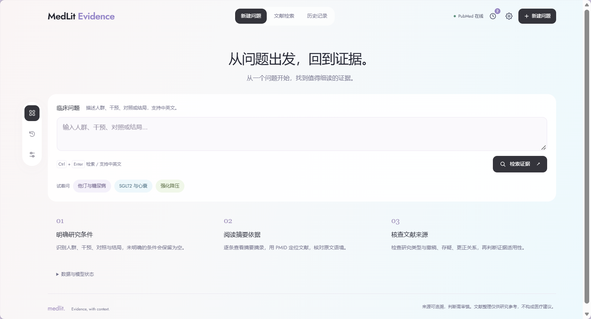

# MedLit Evidence

医学文献检索与摘要整理原型：输入问题，从 PubMed 召回文献，展示研究类型、候选摘要句及完整性标记，供人工核查。

**方向与可信度分开核查。** 按具体结局提取摘要报告的增加、减少或不确定方向，并附 PMID 与完整原句；标明与提问方向是否一致。可信度展示原文明确报告的 GRADE 评级，或通过五项人工核查生成分级草案。方向一致不等于临床结论成立，人工草案未经独立审核；不按文献数量或研究类型生成可信概率。

## 界面预览

### 首页 · 实际运行截图



## 当前能力

- 中英文查询；中文医学词典映射为英文检索词。
- PubMed 分批持续检索、去重词项的 BM25 排序及进程内 TTL 缓存；通过 PICO/有效词项筛选后才进入回答。每批全部匹配文献均可显示，滚动到底部继续加载，不设应用总展示数量上限；大于一万条命中时按 PMID 范围分段。
- PICO 自动识别与手动补充共用同一筛选链路；原问题没有提供的条件明确标注，补充后会参与召回和筛选。
- 逐结局方向依据、原文 GRADE 引用及五项人工核查工作表。方法与边界见 [方向与可信度评估](docs/direction_and_grade.md)。
- 请求失败时回退 11 篇演示语料；在线零结果保持为空。
- 规则 PICO 词项提取与本地筛选：明确识别的人群、干预、对照、结局均须覆盖，词典外的有效英文词项也不能丢弃。未识别的字段不凭空补齐；词项匹配不等于临床语义对齐。
- 优先按明确的 PubMed 发表类型识别研究类型；缺标时仅用标题设计自述、方法/设计小节或明确自述研究的句子保守补充。背景中提及的研究不会抬高分级，冲突或不明确时保留未分级。
- 默认抽取与查询词有重叠的摘要句，保留 PMID 供查证；相关性和句子适用性仍需人工核查。
- 已识别的撤稿文献及撤稿/存疑/更正通知保留在来源列表，但不进入回答或 LLM 上下文。原文章上的存疑和更正标记可同时显示，并提供关联记录链接。
- 可选 LLM 摘要整理；逐条校验实际上下文中的 PMID 和对应原句，自动生成引用。未通过时回退摘要摘录。生成摘要的语义是否受原文支持仍需人工核对。
- 可选 LightGBM 研究模型，显示 0–100 的研究分数；未校准，不代表未来撤稿概率。缺少模型或相关依赖时隐藏徽章，演示改写摘要不评分。

离线摘要是演示用改写，**不是 PMID 对应的 PubMed 原文**。界面会标识演示来源。

## 快速开始

新版开发实现位于 [`codex/evidence-integrity`](https://github.com/QianRongAn/medlit-evidence/tree/codex/evidence-integrity)，可公开获取和运行：

```bash
git clone --branch codex/evidence-integrity https://github.com/QianRongAn/medlit-evidence.git
cd medlit-evidence
# 运行检索与摘要整理
python -m pip install fastapi 'uvicorn[standard]' httpx
python -m uvicorn app.main:app --host 127.0.0.1 --port 8000
```

打开 `http://127.0.0.1:8000/`。网络需要代理时配置 `PUBMED_PROXY` 环境变量；PubMed 默认直连，不继承其他工具的 `HTTP_PROXY` / `HTTPS_PROXY` 设置。

完整训练和模型依赖见 `requirements.txt`：

```bash
python -m pip install -r requirements.txt
```

### 可选 LLM

配置 `LLM_API_KEY`、`LLM_BASE_URL`（OpenAI 兼容地址）和 `LLM_MODEL` 后启用。请求失败时回退抽取式整理。

LLM 必须返回含 `pmid`、`text`、`quote` 的 JSON 条目。服务端只允许引用实际发送的摘要记录，并检查 `quote` 是该摘要片段中的连续原文。摘要正文不得夹带其他引用或链接，引用统一由服务端附加。任何条目无效则整份输出回退，避免部分无效内容被展示。

页面逐条展示摘要整理、可点击 PMID 与对应原句。校验范围是来源成员关系和原句一致性，**不等于摘要语义正确或临床适用性已验证**。不支持约定输出格式的兼容模型会回退摘录。

## API 与迁移

| 方法 | 路径 | 返回内容 |
| --- | --- | --- |
| GET | `/health` | PubMed 连通性、模型可用性、演示语料数量 |
| POST | `/api/search` | 文献、相关性、研究类型和完整性状态 |
| POST | `/api/answer` | 摘要整理、PICO、来源方向、原文评级及分页游标 |
| POST | `/api/grade` | 五项人工核查工作表的分级草案或缺项提示 |

```json
{"query": "他汀类药物会增加新发糖尿病风险吗", "retmax": 20}
```

`query` 去除首尾空白后不能为空，原始长度不超过 2000 字符；`retmax` 为 1–100。

`0.2.0` 的 `evidence` 契约：

- `assessment_version: "2"`。
- `assessment_status: "unassessed"` 表示有候选文献但未完成语义评估；`"no_usable_evidence"` 表示无可用相关文献。
- `confidence: null`、`conflict: null` 表示未评估，不能转换成 0 分或“无冲突”。
- `support_count`、`against_count`、`neutral_count` 暂为 0；未评估数量见 `unassessed_count`，不能把未评估当作中立或无效。
- 摘要句的 `polarity` 为 `"unassessed"`。前端不再展示旧版方向和分数，历史提问保留但旧判定标为停用。

`0.3.0` 新增或变更：

- 保留结果字段名 `risk`；可用时为 `{"kind":"research_model_score","score":73.0,"scale":[0,100],"calibrated":false,"description":"..."}`。`score` 从旧版 0–1 改为 0–100，删除风险 `level`；不能按概率解释。前端拒绝显示旧版概率载荷。不可用或演示语料为 null。
- LLM 模式也返回结构化 `sentences`，每项含 `sentence`、`pmid`、`title`、`quote`、`polarity`，引用编号由程序生成。
- `citation_validation`：LLM 成功时 `status="passed"`、`scope="context_membership_and_quote"`、`content_entailment="unassessed"`；摘录时为 `not_applicable` / `source_excerpts`。
- `llm_fallback_reason`：引用或格式校验失败为 `citation_validation_failed`，服务或响应异常为 `llm_unavailable`，无回退为 null。页面显示回退说明。

`0.4.0` 新增或变更：

- `study_type="notice"` 表示学术通知，`grade="N/A"`。研究类型判定保持 `(type, grade)` 契约，标题与摘要分开处理；规则仍非完整语义理解，分级也不代表质量评估。
- `integrity` 新增 `notice`；保留主状态优先级 `retracted > concern > corrected`，多个状态同时保存在 `integrity_flags`。`corrected` 仅提示存在更正/重发，不保证旧版已被替换或更正无误。
- 结果新增 `is_notice`、`notice_types`（retraction/concern/correction）和 `integrity_relations`（ref_type/pmid/citation）。关联记录缺 PMID 时保留引用信息。
- `evidence.notice_count` 单列通知数量；多状态计数可能重叠。通知不参与回答、LLM 上下文或模型评分。只有旧 `integrity` 字段的本地记录仍受相同过滤。
- 已撤稿旧版与修正后重发的新版分开标记；普通评论、更新和重印不直接触发完整性告警。`ok` 只代表当前元数据未命中这些规则，不能证明文章无问题。

规则、关系方向和 NLM 依据见 [分类与完整性说明](docs/classification_and_integrity.md)。

`0.5.0` 检索筛选变更：

- 搜索与回答共用筛选计划；`results` 只包含通过词项条件的记录，`excluded_results` 保留未纳入候选及原因。通知与撤稿原文即使词项通过，也仅供核查，`answer_eligible=false`。
- `screening` 返回候选、命中、展示和排除数量，以及 `pico_constraints`、其他有效词项、未映射词项和查询解析问题；单篇 `screening` 给出各字段 required/matched/missing。
- `relevance` 改为查询词项覆盖百分比，不再把候选中的最高 BM25 强行归一到 100；`bm25_score` 保留原始排序分。覆盖 100% 不代表临床适用性或结论可信度。
- 人群和对照在标题/摘要检查，明确结局须在摘要出现。缺少摘要或条件不覆盖时不生成回答；抽取句和 LLM 引用原句也须覆盖所问结局的词项。
- 普通糖尿病不再默认等于 2 型；新发糖尿病风险不再当作既有糖尿病人群；英文药名采用词边界，具体比较药物不再折叠成同一药物类别。
- 未映射中文、数字阈值/时窗、排除人群或“或者”条件暂不能可靠解析时明确弃权，不删除条件后放宽搜索结果。离线演示先筛选再按返回上限截断。

本地规则与保守召回边界见 [检索与 PICO 筛选说明](docs/retrieval_screening.md)。

`0.6.0` 查询与摘录变更：翻译和PICO共用术语表，补充中文问句处理；抽取按整节过滤背景/方法，保留结果不确定性，`source_section`记录章节。缩写分句保留完整数值比较，LLM上下文只发送完整可用句并要求完整原句引用。

### 0.7.0：PICO、连续加载与评估工作表

`retmax` 控制网络批次规模（1–100），不再作为匹配文献的总展示上限。每次先检查 `max(100, retmax × 5)` 篇候选，最多每批 500 篇；返回本批全部匹配记录。将 `screening.next_cursor` 原样带回相同查询与 PICO 即可继续，直到游标为 null。后续网络失败返回错误，保留已有结果，不拼接离线语料。

可选 `pico` 对象包含字符串字段 `population`、`intervention`、`comparison`、`outcome`，每字段不超过 200 字；留空沿用原问题，多个条件可用顿号分隔。原文缺少的条件不从检索结果倒推。明确的否定、未支持的数字条件和未映射中文仍须保留并提示处理。

`results[].reported_assessment` 给出逐结局报告方向、与提问方向的对应关系、PMID、原句及原文 GRADE 评级；这是可核查的摘要抽取，不是对因果性和临床适用性的自动证明。旧 `confidence`/`conflict` 保持 null，避免旧客户端把新抽取规则当作已校准临床评分。

## 研究资产与边界

仓库含试点与全量特征表、模型文件、SHAP 图、消融及引文信号实验脚本：

- [全量模型历史报告](data/model_report_large.md)
- [引文信号历史报告](data/citation_signal_report.md)
- [多信号研究方案](docs/credibility_cross_validation.md)

以上是探索性结果。已统一 AP 与同折常量基线，显式年份切点和严格固定观察窗校验；方法与真实重跑结果见 [评估协议 v2](docs/evaluation_protocol.md)。当前数据采样、发表年份删失、预测时点来源和概率校准仍有待验证，不能据此认定某篇文献会在未来撤稿。`data/integrity_signals.jsonl` 为被忽略的本地产物，当前仓库不足以独立复现引文信号报告。

## 临床检索与摘要初评

已建立 [独立来源评测集](evaluation/clinical_v1/) 并冻结先标注后运行：30个中英文问题、12篇真实PubMed报告、360项文献判断。初稿由开发者模型审核，临床专家盲审待完成，不是整体临床正确率。

固定候选池中，返回文献主题相关17/17，严格PICO匹配15/17；抽取句语境忠实23/26。但有效回答覆盖仅8/24，中文仅1/12。PICO四字段解析全对6/30，生成式LLM尚未评估。完整分母、失败案例与复现方法见 [初评报告](docs/clinical_benchmark_report.md) 和 [评测协议](docs/clinical_benchmark_protocol.md)。

已据此修复三个P1：中文覆盖、背景时间语境、vs.分句。在同一**已知开发基准**上，有效回答覆盖从8/24到22/24，中文从1/12到11/12；严格PICO文献匹配从15/17到26/30，错误人群仍待处理。62项新抽取句经模型逐句复核均受原文支持，不能解读为总体100%正确。详见 [P1修复与复测](docs/p1_context_repair.md)。

## 测试与后续工作

```bash
python -m unittest discover -s tests -v
node --test tests/test_ui.cjs
```

Python 测试替换外部网络服务，不需要密钥或预训练模型；评估回归需要安装 requirements.txt 中的科学计算依赖。GitHub Actions 在 Python 3.10 / 3.12 下验证后端，并运行前端状态回归测试。

[项目状态](docs/project_status.md) · [项目审查与优先级](docs/project_review.md)

本工具仅供研究与信息整理，不构成医疗建议。

## License

MIT
